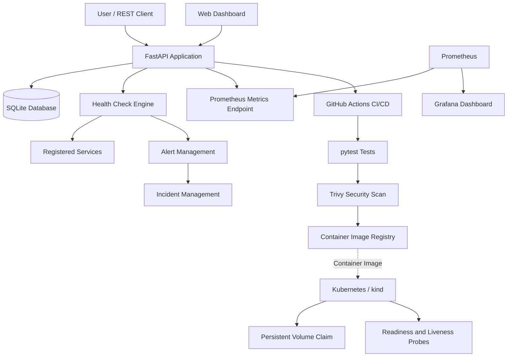

# Service Reliability Platform (SRP)

**A hands-on DevOps and Site Reliability Engineering project for service monitoring, incident detection, observability, and deployment recovery.**

SRP is a lightweight service reliability platform built with Python and FastAPI. It monitors registered services, tracks health-check results and response times, detects repeated failures, manages alerts and incidents, and exposes application metrics for Prometheus and Grafana.

The project demonstrates an end-to-end DevOps workflow, from application development and automated testing to containerization, security scanning, Kubernetes deployment, persistent storage, and failure recovery.

**Repository:** [service-reliability-platform](https://github.com/aditirajput18/service-reliability-platform)

---

## Key Features

- **Service Registry:** Register, view, and manage monitored services through REST APIs and a web dashboard.
- **Health Monitoring:** Perform HTTP health checks and record service status, HTTP status codes, and response times.
- **Alert Management:** Generate alerts after consecutive health-check failures and resolve active alerts when services recover.
- **Incident Management:** Track incidents associated with service failures and their recovery lifecycle.
- **Observability:** Export custom Prometheus metrics for health checks, current service status, and check duration.
- **Monitoring Dashboards:** Use Grafana to visualize metrics collected by Prometheus.
- **Containerization:** Package the application using Docker and run the application and monitoring stack with Docker Compose.
- **CI/CD Automation:** Run automated tests, build container images, scan for vulnerabilities, and publish images through GitHub Actions.
- **Security Scanning:** Integrate Trivy into the container build pipeline with a HIGH/CRITICAL vulnerability gate.
- **Kubernetes Deployment:** Deploy the application to a local kind cluster using Kubernetes Deployments, Services, ConfigMaps, and PersistentVolumeClaims.
- **Failure Recovery:** Simulate an unavailable container image, investigate `ErrImagePull`, roll back the Deployment, and verify application recovery.
- **Automated Testing:** Use pytest to validate application functionality and reliability-related behavior.

---

## Architecture



### Application and monitoring flow

1. Services are registered through the API or dashboard.
2. Health checks record availability, HTTP status, and response time.
3. Repeated failures trigger alerts, and recovery can resolve active alerts.
4. The application exposes custom metrics through `/metrics`.
5. Prometheus scrapes application metrics, and Grafana visualizes the collected data.
6. GitHub Actions automates testing, image building, vulnerability scanning, and image publishing.
7. Kubernetes runs the application with health probes and persistent database storage.
8. Deployment failures can be investigated and recovered using Kubernetes rollout history and rollback commands.

---

## Technology Stack

| Technology | Purpose |
|---|---|
| Python | Application development |
| FastAPI | REST API framework |
| SQLAlchemy | Database ORM |
| SQLite | Persistent application data |
| HTML, CSS, JavaScript | Web dashboard |
| pytest | Automated testing |
| Docker | Containerization |
| Docker Compose | Local application and monitoring stack |
| GitHub Actions | CI/CD automation |
| Trivy | Container vulnerability scanning |
| GitHub Container Registry | Container image publishing |
| Prometheus | Metrics collection |
| Grafana | Monitoring and visualization |
| Kubernetes | Application orchestration |
| kind | Local Kubernetes cluster |
| kubectl | Kubernetes management |

---

## Getting Started

### Prerequisites

Install the following tools:

- Python 3.12 or a compatible version
- Git
- Docker Engine
- Docker Compose
- kind and kubectl for the Kubernetes deployment

### 1. Clone the repository

```bash
git clone https://github.com/aditirajput18/service-reliability-platform.git
cd service-reliability-platform
```

### 2. Set up the Python environment

```bash
python3 -m venv venv
source venv/bin/activate

pip install -r requirements.txt
```

### 3. Run the application locally

```bash
uvicorn app.main:app --reload
```

Access the application at:

| Resource | URL |
|---|---|
| Web dashboard | http://localhost:8000 |
| API documentation | http://localhost:8000/docs |
| Application health | http://localhost:8000/health |
| Prometheus metrics | http://localhost:8000/metrics |

Run the automated tests:

```bash
pytest -q
```

---

## Run with Docker Compose

Build and start the application and monitoring services:

```bash
docker compose up -d --build
```

Check the running containers:

```bash
docker compose ps
```

View application logs:

```bash
docker compose logs --tail=100 srp-app
```

Access the services:

| Service | URL |
|---|---|
| SRP application | http://localhost:8000 |
| Prometheus | http://localhost:9090 |
| Grafana | http://localhost:3000 |

The Compose configuration uses persistent volumes for application and monitoring data. Preserve those volumes when restarting or updating the stack if you need to retain existing data.

---

## Kubernetes Deployment

The project includes Kubernetes manifests in the `k8s/` directory for the local kind cluster.

### Resources

- **Deployment:** Runs the SRP application.
- **Service:** Exposes the application inside the cluster.
- **ConfigMap:** Supplies the database connection configuration.
- **PersistentVolumeClaim:** Provides persistent storage for the SQLite database.
- **Readiness probe:** Checks whether the application is ready to serve traffic.
- **Liveness probe:** Checks application health.

### Create the local cluster

```bash
kind create cluster --config k8s/kind-config.yaml
kubectl get nodes
```

### Deploy the application

Apply the manifests in order:

```bash
kubectl create namespace srp

kubectl apply -f k8s/srp-configmap.yaml
kubectl apply -f k8s/srp-pvc.yaml
kubectl apply -f k8s/srp-deployment.yaml
kubectl apply -f k8s/srp-service.yaml
```

If the namespace already exists, continue without recreating it.

Make sure the image reference in `k8s/srp-deployment.yaml` points to an image available to your cluster. For a locally built image, build and load that image into kind before deploying it.

Check the deployment:

```bash
kubectl get deployment,pods,svc,pvc -n srp
kubectl get nodes
```

### Access the Kubernetes application

Forward local port `8001` to the application Service:

```bash
kubectl port-forward -n srp service/srp-service 8001:8000
```

In another terminal, verify the application:

```bash
curl http://localhost:8001/health
curl http://localhost:8001/metrics
```

The Kubernetes database is configured to use `/data/srp.db`, mounted through the `srp-data-pvc` claim. The Deployment uses a `Recreate` strategy to avoid concurrent application Pods writing to the same SQLite database.

**Important:** Do not delete the PVC or its backing volume if you need to preserve the Kubernetes database.

---

## Prometheus Metrics

SRP exposes custom application metrics at `/metrics`.

| Metric | Description |
|---|---|
| `srp_health_checks_total` | Total health checks, labelled by service and status |
| `srp_service_status` | Current service status: `1` for UP and `0` for DOWN |
| `srp_health_check_duration_seconds` | Distribution of health-check durations |

Example:

```bash
curl -sS http://localhost:8000/metrics | grep '^srp_'
```

Trigger a health check through the API to record service-specific metric values:

```bash
curl -sS -X POST http://localhost:8000/api/services/1/check
```

Replace `1` with an existing service ID.

Prometheus collects the exposed metrics, while Grafana provides dashboards for visualization. Application metric values are held in process memory and can reset when the application restarts; persisted service and incident records are stored separately in SQLite.

---

## CI/CD and Security

The GitHub Actions pipeline automates the main container delivery workflow.

1. Set up the Python environment.
2. Install application dependencies.
3. Execute automated tests.
4. Build the Docker image.
5. Scan the image with Trivy for HIGH and CRITICAL vulnerabilities, ignoring unfixed vulnerabilities according to the workflow configuration.
6. Publish the image to GitHub Container Registry on eligible pushes.

The security gate is designed to prevent the workflow from continuing to image publishing when the configured vulnerability scan fails.

---

## Failure Simulation and Recovery

A controlled Kubernetes failure was introduced by configuring the Deployment to use an unavailable image:

```bash
kubectl set image deployment/srp-app \
  srp-app=srp-k8s:failure-simulation -n srp
```

The Pod entered `ErrImagePull` because the requested image was unavailable.

### Investigation

```bash
kubectl get pods -n srp
kubectl describe deployment srp-app -n srp
kubectl get events -n srp --sort-by='.lastTimestamp'
```

### Recovery

The previous Deployment revision was restored:

```bash
kubectl rollout undo deployment/srp-app -n srp
kubectl rollout status deployment/srp-app -n srp --timeout=120s
```

The application was confirmed healthy after rollback, and the PersistentVolumeClaim remained bound throughout the exercise.

This exercise demonstrates how to identify an image-pull failure, inspect Kubernetes events, restore a working Deployment revision, and verify recovery.

---

## Testing and Verification

The project has been tested across application, container, monitoring, and Kubernetes workflows.

- **Automated tests:** 27 tests passed in the recorded test run.
- **Health monitoring:** Both UP and DOWN health-check outcomes recorded.
- **Prometheus:** Custom metrics verified at the application metrics endpoint.
- **Grafana:** Monitoring stack verified running and accessible.
- **Kubernetes:** Deployment, Service, and persistent storage verified.
- **Persistence:** Application data verified after Pod replacement.
- **Rollback:** Controlled image-pull failure diagnosed and recovered.

These are results from recorded verification runs, not a guarantee that every component has been re-tested on every subsequent code change.

---

## Project Structure

```text
service-reliability-platform/
├── app/
│   ├── main.py
│   ├── database.py
│   ├── models.py
│   ├── schemas.py
│   ├── crud.py
│   ├── monitoring.py
│   └── routers/
├── tests/
├── static/
├── k8s/
│   ├── kind-config.yaml
│   ├── srp-configmap.yaml
│   ├── srp-pvc.yaml
│   ├── srp-deployment.yaml
│   └── srp-service.yaml
├── .github/
│   └── workflows/
├── Dockerfile
├── docker-compose.yml
├── requirements.txt
└── README.md
```

---

## Key Learnings

Building SRP provided hands-on experience with:

- Designing REST APIs and persistent application data models.
- Implementing service health checks, alerting, and incident workflows.
- Containerizing an application and operating a multi-container stack.
- Automating tests, image builds, and vulnerability scanning.
- Exposing application metrics and integrating Prometheus with Grafana.
- Deploying applications with Kubernetes health probes and persistent storage.
- Diagnosing failed image pulls and recovering deployments with rollbacks.
- Validating application health and data persistence after recovery.

## Future Improvements

Potential next steps include:

- Add an end-to-end integration test for the full monitoring and incident lifecycle.
- Automate Kubernetes deployment through a verified CI/CD workflow.
- Add notification integrations for active alerts.
- Add service-level objectives (SLOs), error budgets, and availability reporting.
- Improve dashboard screenshots and incident runbooks for operational documentation.

---

## Author

**Aditi Rajput**

Computer Science graduate interested in DevOps, Cloud Engineering, and Site Reliability Engineering.

GitHub: [@aditirajput18](https://github.com/aditirajput18)

---

*Built as a hands-on project to practice reliable application delivery, observability, and operational recovery using open-source tools.*

